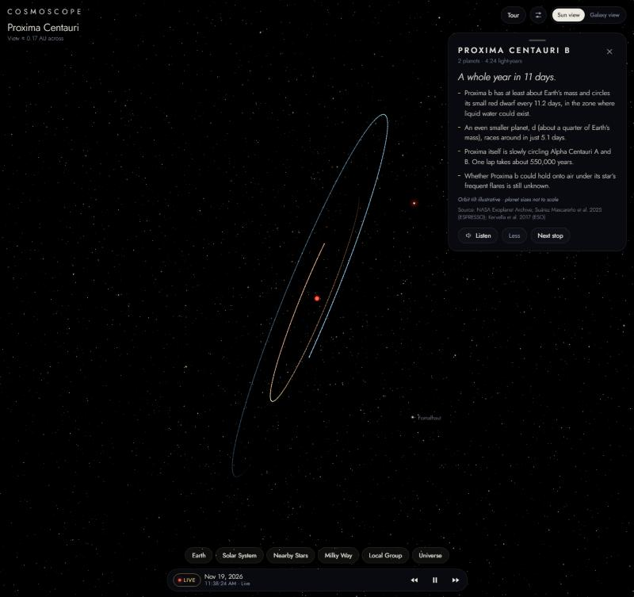

# Cosmoscope

**An interactive, zoomable map of the universe that shows how everything moves.**

▶ **Live:** https://syntheticbuilder.github.io/cosmoscope/



Start hovering over Earth, then pinch or scroll outward through the Solar System, the nearby stars, the Milky Way, the Local Group and the cosmic web, all the way to the edge of the observable universe. Speed up time and watch it move: planets dragged through the galaxy in spiral trails, binary stars circling each other, stars drifting across the sky.

## What's inside
- **Real positions, right now.** The Sun, planets, Pluto and the Moon are placed with [Astronomy Engine](https://github.com/cosinekitty/astronomy).
- **109,000 real stars** from the HYG catalog, at their measured distances and drifting with their measured motions.
- **Search and Atlas.** Find any of the 109,400 stars by its real catalog name (Bayer, Flamsteed, Gliese, HD, HIP), plus every planet and story stop. Read the card, or fly there. The Atlas lists everything A to Z by category.
- **88 constellations.** Fly to one to see its figure from the Solar System, then zoom out to watch the shape fall apart at the stars' real distances. Optional lines for all of them in Settings.
- **Full screen.** One tap hides every control for a clean view that stays fully interactive; Esc or the faint corner button brings them back.
- **Galaxy view.** Turns ordinary orbits into the spirals they really trace as the Sun races around the Milky Way.
- **Story stops and a guided tour.** Each stop has a short card with a source for every fact, plus optional narration.
- **New worlds.** Planets added to NASA's Exoplanet Archive in the last 90 days, refreshed every 6 hours, with a one-time fly-in to the newest find.
- **Time controls**, from live up to a million years per second, forwards or backwards.

Anything drawn bigger or brighter than real life is labeled "not to scale" on screen.

## Data sources
NASA Exoplanet Archive · HYG star catalog · Stellarium modern sky culture (constellations, CC BY-SA 4.0) · Astronomy Engine · NASA Blue Marble & Black Marble imagery · NASA, ESA and ESO for story facts (each card names its source).

## Run it locally
Needs [Node.js](https://nodejs.org/) 20 or newer.

```bash
npm install
bash build.sh                                     # builds the site into dist/
node tools/fetch_exoplanets.mjs dist/new_planets.json   # optional: today's new planets
# optional: rebuild the search index and constellations (generated files are already committed)
# downloads: hygdata_v41.csv from github.com/astronexus/HYG-Database (hyg/CURRENT/)
#            index.json from github.com/Stellarium/stellarium (skycultures/modern/)
node tools/prep_search.mjs hygdata_v41.csv index.json public
npx esbuild --servedir=dist --serve=8080          # open http://localhost:8080
```

`npm test` runs the automatic tests.

## How it's published
A GitHub Actions workflow (`.github/workflows/site.yml`) runs on every push to `main` and every 6 hours. It builds the site, fetches the newest planets from NASA, and deploys to GitHub Pages.

## License
Code: MIT (see `LICENSE`). Imagery and data belong to their sources listed above (NASA imagery is public domain; HYG catalog is CC BY-SA).
